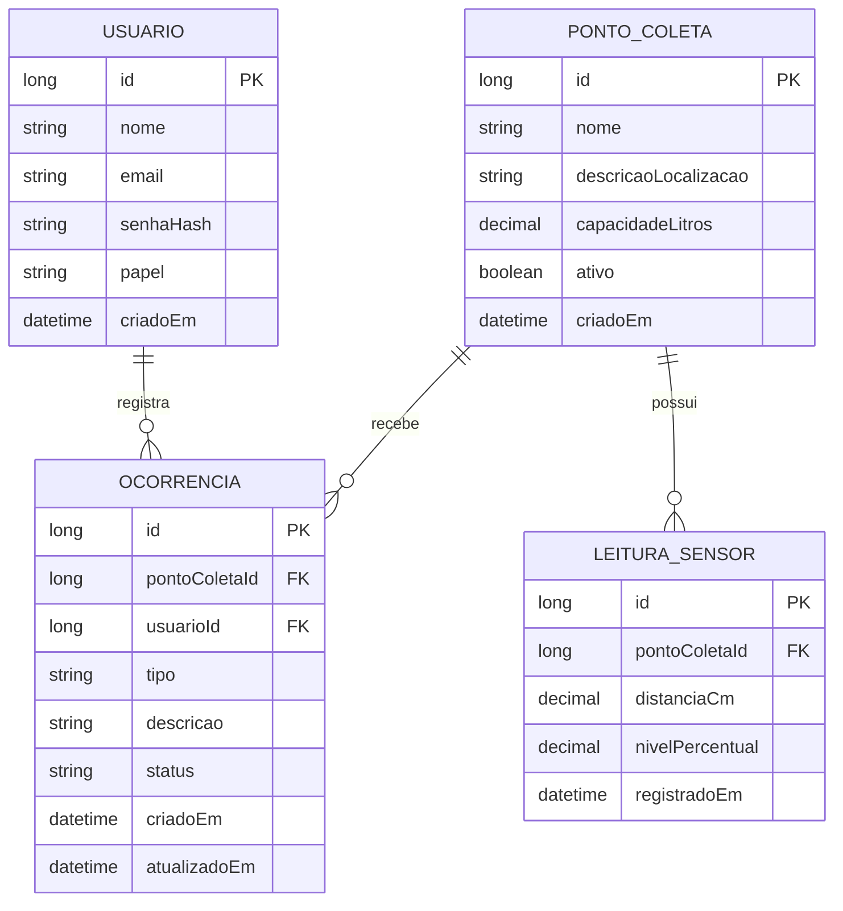

# Binova | Java Advanced - FIAP Global Solution 2026/2

O **Binova** é um projeto desenvolvido para a Global Solution 2026/2 da FIAP, dentro da proposta **CitizenTech**. A ideia é contribuir para o acompanhamento de pontos de coleta de resíduos, reunindo informações sobre o nível de preenchimento das lixeiras e os problemas relatados pelos cidadãos.

Nesta etapa, desenvolvemos uma **API REST em Java 21 e Spring Boot 4.1.2**. Por meio dela, é possível cadastrar pontos de coleta, registrar leituras de sensores, consultar a situação das lixeiras e gerenciar ocorrências. As leituras são recebidas pela API, o que permite demonstrar o fluxo mesmo sem um dispositivo físico conectado.

## Integrantes

- Gustavo de Jesus - RM 567926
- Gustavo Siciliano - RM 568419
- Samuel Keniti - RM 567614
- Manuel Pedro - RM 567458
- Vinicius Morrone - RM 566884

## Tecnologias utilizadas

O projeto utiliza Java 21, Spring Boot 4.1.2, Spring Web, Spring Data JPA, Spring Security, JWT, BCrypt, Bean Validation, Spring HATEOAS, cache, Swagger/OpenAPI e H2. Os testes automatizados utilizam JUnit 5 e MockMvc, e o Spring Boot Actuator disponibiliza informações básicas de monitoramento.

Optamos pelo **H2** para facilitar a execução e a avaliação do trabalho. Na aplicação principal, o banco é armazenado em arquivo; nos testes, é utilizado um banco separado, em memória.

## Como executar

É necessário ter o **Java 21** instalado e acesso à internet na primeira execução, para que o Maven possa baixar as dependências.

1. Abra o projeto no IntelliJ IDEA ou VS Code, na pasta que contém o arquivo `pom.xml`.
2. Execute o comando correspondente ao seu sistema operacional:

   **Windows (PowerShell):**

   ```powershell
   .\mvnw.cmd spring-boot:run
   ```

   **Linux ou macOS:**

   ```bash
   ./mvnw spring-boot:run
   ```

3. Com a aplicação iniciada, acesse o [Swagger](http://localhost:8080/swagger-ui.html) para visualizar e testar os endpoints.
4. Para consultar o banco localmente, abra o [H2 Console](http://localhost:8080/h2-console) e informe:

   | Campo | Valor |
         |---|---|
   | JDBC URL | `jdbc:h2:file:./data/binova` |
   | Usuário | `sa` |
   | Senha | Deixar em branco |

Os dados são armazenados no arquivo `data/binova.mv.db` e permanecem disponíveis após reiniciar a aplicação. O Hibernate gerencia a criação e atualização das tabelas com `ddl-auto: update`. A pasta `data/` está incluída no `.gitignore` e não deve ser enviada ao GitHub.

## Contas para demonstração

A aplicação permite criar duas contas fictícias, uma de **administrador** e outra de **cidadão**. Por segurança, essa opção fica desativada por padrão no `application.yml`.

Para habilitá-la localmente, defina as variáveis abaixo no PowerShell antes de iniciar o projeto:

```powershell
$env:APP_DEMO_ENABLED="true"
$env:APP_DEMO_ADMIN_PASSWORD="AdminLocal2026"
$env:APP_DEMO_CIDADAO_PASSWORD="CidadaoLocal2026"

.\mvnw.cmd spring-boot:run
```

As contas criadas serão:

| Perfil | E-mail | Senha no exemplo |
|---|---|---|
| Administrador | `admin@binova.local` | `AdminLocal2026` |
| Cidadão | `cidadao@binova.local` | `CidadaoLocal2026` |

Essas senhas são **apenas exemplos para testes locais** e não devem ser reutilizadas em ambientes reais. O sistema armazena as senhas utilizando **BCrypt** e não recria contas que já existam no banco. Portanto, alterar a variável de ambiente não troca a senha de um usuário já cadastrado.

A autenticação utiliza **JWT**. Se `BINOVA_JWT_SECRET` não estiver definida, o serviço gera uma chave temporária ao iniciar; nesse caso, os tokens anteriores deixam de funcionar depois de uma reinicialização. Para manter a mesma chave, configure essa variável com um segredo seguro em Base64, correspondente a pelo menos 32 bytes, sem incluí-lo no repositório.

## Testando a API pelo Swagger

O Swagger permite executar as requisições diretamente pelo navegador. Para demonstrar o fluxo principal:

1. Acesse `POST /api/auth/login` e faça login com uma das contas de demonstração. Para o administrador, por exemplo:

   ```json
   {
     "email": "admin@binova.local",
     "senha": "AdminLocal2026"
   }
   ```

2. Copie o campo `token` retornado, clique em **Authorize** no Swagger e informe o JWT.
3. Cadastre um ponto em `POST /api/pontos-coleta`:

   ```json
   {
     "nome": "Lixeira da biblioteca",
     "descricaoLocalizacao": "Entrada da biblioteca",
     "capacidadeLitros": 80
   }
   ```

4. Consulte `GET /api/pontos-coleta` e anote o `id` criado. Em seguida, registre uma leitura em `POST /api/pontos-coleta/{pontoId}/leituras`:

   ```json
   {
     "distanciaCm": 12,
     "nivelPercentual": 85
   }
   ```

5. Acesse `GET /api/pontos-coleta/{id}/situacao`. Para uma leitura recente com 85% de preenchimento, o resultado esperado é `PROXIMA_DO_LIMITE`.
6. Faça login com a conta de cidadão e registre uma ocorrência em `POST /api/ocorrencias`:

   ```json
   {
     "pontoColetaId": 1,
     "tipo": "LIXEIRA_CHEIA",
     "descricao": "Lixeira cheia na entrada da biblioteca"
   }
   ```

   Substitua `1` pelo ID do ponto cadastrado. Depois, com a conta de administrador, é possível alterar o atendimento por `PATCH /api/ocorrencias/{id}/status`:

   ```json
   {
     "status": "EM_ATENDIMENTO"
   }
   ```

## Principais endpoints

| Método | Rota | Acesso |
|---|---|---|
| `POST` | `/api/auth/cadastro` | Público; cadastra um cidadão |
| `POST` | `/api/auth/login` | Público |
| `GET` | `/api/usuarios/me` | Autenticado |
| `GET` | `/api/pontos-coleta` | Público; filtros e paginação |
| `GET` | `/api/pontos-coleta/busca-nome` | Público; pesquisa por nome |
| `GET` | `/api/pontos-coleta/{id}` | Público; detalhes e links HATEOAS |
| `GET` | `/api/pontos-coleta/{id}/situacao` | Público; situação da última leitura |
| `POST` | `/api/pontos-coleta` | Administrador |
| `PUT`, `DELETE` | `/api/pontos-coleta/{id}` | Administrador |
| `PATCH` | `/api/pontos-coleta/{id}/reativar` | Administrador |
| `GET` | `/api/pontos-coleta/{pontoId}/leituras` | Autenticado |
| `GET` | `/api/pontos-coleta/{pontoId}/leituras/{id}` | Autenticado |
| `POST` | `/api/pontos-coleta/{pontoId}/leituras` | Administrador |
| `GET`, `POST` | `/api/ocorrencias` | Autenticado |
| `GET`, `PUT`, `DELETE` | `/api/ocorrencias/{id}` | Autenticado, conforme autoria e regras de negócio |
| `PATCH` | `/api/ocorrencias/{id}/status` | Administrador |
| `GET` | `/actuator/health`, `/actuator/info` | Público |
| `GET` | `/actuator/metrics` | Administrador |

Nas listagens, é possível utilizar parâmetros como `page`, `size` e `sort`. A consulta de pontos também aceita os filtros `termo` e `ativo`, enquanto a listagem de ocorrências aceita o filtro `status`.

O histórico de leituras exige autenticação, mesmo que a consulta dos pontos e da situação das lixeiras seja pública. A documentação OpenAPI também pode ser consultada em `/v3/api-docs`.

## Modelo de dados

O modelo contém quatro entidades principais: **Usuario**, **PontoColeta**, **LeituraSensor** e **Ocorrencia**.



Os relacionamentos são mapeados com JPA, utilizando `@ManyToOne` e `@OneToMany`. As leituras pertencem a um ponto de coleta, enquanto as ocorrências estão associadas a um ponto e ao cidadão que as registrou.

A exclusão de pontos de coleta é **lógica**: o campo `ativo` passa a ser `false`, preservando as leituras e ocorrências anteriores. Não utilizamos exclusão em cascata nesses relacionamentos.

## Decisões técnicas e regras de negócio

Além do CRUD, o projeto utiliza diferentes formas de consulta com Spring Data JPA. Os métodos derivados do repositório atendem a buscas simples, como pontos ativos e a leitura mais recente de cada ponto. A pesquisa textual por nome utiliza **JPQL**, e a classe `PontoSpecifications` combina filtros opcionais de nome e atividade. As listagens também oferecem paginação e ordenação.

O **cache** é aplicado à consulta de detalhes dos pontos de coleta. Quando um ponto é cadastrado, atualizado, desativado ou reativado, as entradas correspondentes são invalidadas para evitar informações desatualizadas.

Com **HATEOAS**, as respostas apresentam links para recursos relacionados, como a situação e as leituras de um ponto. As ações administrativas são exibidas de acordo com o perfil autenticado, mas as permissões são efetivamente verificadas pelo Spring Security e pelos serviços.

A situação das lixeiras é calculada a partir da leitura mais recente:

| Nível de preenchimento | Situação |
|---|---|
| Abaixo de 50% | `DISPONIVEL` |
| De 50% até menos de 80% | `ATENCAO` |
| De 80% a 100% | `PROXIMA_DO_LIMITE` |

Essa classificação considera apenas leituras válidas, realizadas nos últimos **15 minutos**. Na ausência de dados recentes, ou quando a leitura é inválida, o retorno é `SEM_DADOS_ATUALIZADOS`.

A autenticação utiliza JWT e senhas protegidas por BCrypt. Os perfis **CIDADAO** e **ADMIN** definem o acesso às operações. Os DTOs aplicam validações aos dados recebidos, e o tratamento de exceções contempla respostas HTTP como **400, 403, 404 e 409**. As respostas de autenticação, incluindo **401**, também são tratadas pela configuração do Spring Security.

## Testes automatizados

Os testes estão em `src/test/java` e foram organizados para verificar diferentes partes da aplicação:

- `BinovaApplicationTests`: inicialização do contexto Spring Boot;
- `JwtServiceTest`: geração e validação de JWT e rejeição de chave curta;
- `SituacaoPontoServiceTest`: limites de preenchimento e validade das leituras;
- `FluxoApiTest`: fluxo HTTP com cadastro, login, permissões, pontos de coleta, leituras, ocorrências, filtros, cache e links HATEOAS.

Para executar a verificação completa no Windows:

```powershell
.\mvnw.cmd clean verify
```

No Linux ou macOS:

```bash
./mvnw clean verify
```

O perfil `test` utiliza as configurações de `src/test/resources/application-test.yml`, com **H2 em memória**, separado do banco persistente da aplicação. O teste integrado habilita suas próprias contas de demonstração, sem depender de cadastros feitos manualmente.
