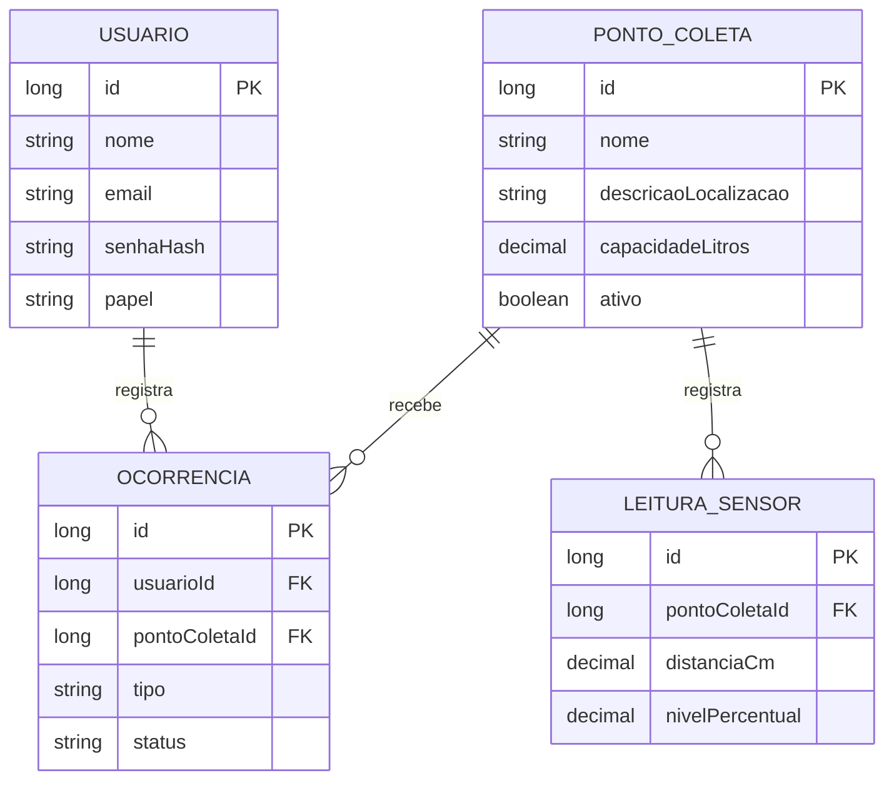

# Binova - Java Advanced | FIAP Global Solution 2026/2

API REST do **Binova** (CitizenTech), desenvolvida em **Java 21 + Spring Boot 4.1.2** com **H2 em arquivo**.
Permite consultar pontos de coleta, registrar leituras das lixeiras e acompanhar ocorrencias de descarte.

## Integrantes

- Gustavo de Jesus - RM 567926
- Gustavo Siciliano - RM 568419
- Samuel Keniti - RM 567614
- Manuel Pedro - RM 567458
- Vinicius Morrone - RM 566884

## Como executar

Requisitos: **Java 21** e acesso a internet na primeira execucao para baixar dependencias Maven.

1. Abra a pasta extraída no IntelliJ IDEA ou VS Code (a pasta que contém o `pom.xml`).
2. No Windows, execute na raiz:

   ```powershell
   .\mvnw.cmd clean spring-boot:run
   ```

   No macOS/Linux: `./mvnw clean spring-boot:run`.
3. Acesse **http://localhost:8080/swagger-ui.html** para testar a API.
4. Para ver os dados, acesse **http://localhost:8080/h2-console** e use:
   - JDBC URL: `jdbc:h2:file:./data/binova`
   - Usuario: `sa`
   - Senha: (em branco)

**Persistencia:** o banco e armazenado em `data/binova.mv.db` (ignorado no Git). Ao reiniciar o app, os dados continuam la.
As tabelas sao geradas pelo Hibernate (`ddl-auto: update`), sem comandos SQL manuais.

## Usuarios de teste (somente demonstracao local)

| Papel | Email | Senha |
|---|---|---|
| ADMIN | `admin@binova.local` | `Admin@12345` |
| CIDADAO | `cidadao@binova.local` | `Cidadao@12345` |

O projeto cria esses usuarios ficticios na primeira inicializacao, desde que `BINOVA_DEMO=true` (padrao **apenas para a demonstracao academica**). As senhas sao gravadas com **BCrypt**. Para desativar criacao automatica: `BINOVA_DEMO=false`.
As credenciais acima nao sao de servicos externos e **nao devem ser usadas em producao**.

**JWT:** sem `JWT_SECRET_BASE64`, a API gera uma chave aleatoria na memoria ao iniciar. Os tokens anteriores deixam de funcionar apos reiniciar. Para chave persistente, configure uma variavel de ambiente `JWT_SECRET_BASE64` com 32 ou mais bytes aleatorios em Base64. Nunca versionar chaves reais.

## Swagger e login

1. Abra `POST /api/auth/login`.
2. Envie o JSON:

   ```json
   {"email":"admin@binova.local","senha":"Admin@12345"}
   ```

3. Copie o valor da propriedade `token` da resposta.
4. Clique **Authorize** no Swagger e cole o **token JWT** (o Swagger usa o esquema Bearer).
5. Teste `POST /api/pontos-coleta`:

   ```json
   {"nome":"Lixeira da biblioteca","descricaoLocalizacao":"Entrada da biblioteca","capacidadeLitros":80}
   ```

6. Consulte `GET /api/pontos-coleta`, anote o `id` e envie `POST /api/pontos-coleta/{pontoId}/leituras`:

   ```json
   {"distanciaCm":12,"nivelPercentual":85}
   ```

7. Consulte `GET /api/pontos-coleta/{id}/situacao`. A situacao deve ser `PROXIMA_DO_LIMITE` para leitura recente com 85%.
8. Autentique como `CIDADAO` e teste `POST /api/ocorrencias`:

   ```json
   {"pontoColetaId":1,"tipo":"LIXEIRA_CHEIA","descricao":"Lixeira cheia na biblioteca"}
   ```

   Substitua `1` pelo ID do ponto criado. O ADMIN pode mudar o status por `PATCH /api/ocorrencias/{id}/status` com `{"status":"EM_ATENDIMENTO"}`.

## Endpoints principais

| Metodo | Rota | Acesso |
|---|---|---|
| POST | `/api/auth/cadastro` | Publico (cria CIDADAO) |
| POST | `/api/auth/login` | Publico |
| GET | `/api/usuarios/me` | Autenticado |
| GET | `/api/pontos-coleta` | Publico: Specification com filtros `termo`, `ativo`, `page`, `size`, `sort` |
| GET | `/api/pontos-coleta/busca-nome?nome=` | Publico: JPQL |
| GET | `/api/pontos-coleta/{id}` | Publico: cache e links HATEOAS |
| GET | `/api/pontos-coleta/{id}/situacao` | Publico: leitura recente e classificacao |
| POST, PUT, DELETE | `/api/pontos-coleta` e `/{id}` | ADMIN |
| PATCH | `/api/pontos-coleta/{id}/reativar` | ADMIN |
| GET | `/api/pontos-coleta/{id}/leituras` e `/{leituraId}` | Autenticado |
| POST | `/api/pontos-coleta/{id}/leituras` | ADMIN |
| GET, POST, PUT, DELETE | `/api/ocorrencias` e `/{id}` | Autenticado, respeita autoria |
| PATCH | `/api/ocorrencias/{id}/status` | ADMIN |
| GET | `/actuator/health`, `/actuator/info` | Publico |
| GET | `/actuator/metrics` | ADMIN |

O Swagger descreve cada rota com `@Operation` em `/v3/api-docs`. A listagem e os detalhes dos pontos
são públicos, mas **o histórico de leituras exige login**. Os links de edição e status só aparecem
quando o usuário tem permissão. Os erros sao padronizados em JSON por `@RestControllerAdvice` (400, 401, 403, 404, 409).

## Entidades e relacionamentos



As relacoes sao `@ManyToOne(fetch=LAZY)` do lado das leituras e ocorrencias e `@OneToMany(mappedBy=...)` nos pontos e usuarios. Nao foi aplicado cascade de exclusao para **preservar o historico**. A exclusao dos pontos e **logica** (`ativo=false`).

## Justificativa tecnica

- **Query method derivado:** `findByAtivoTrue` (usado em `GET /api/pontos-coleta?ativo=true`) e `findFirstByPontoColetaIdOrderByRegistradoEmDesc` representam consultas simples do domínio.
- **JPQL:** `buscarPorNome` permite pesquisa textual pelo nome da lixeira, sem SQL especifico do H2.
- **Specification:** `PontoSpecifications.filtros` combina termo e situação de atividade em `GET /api/pontos-coleta?termo=...&ativo=true`, com paginação e ordenação.
- **Cache:** `@Cacheable` no detalhe de um ponto, consulta frequente e pouco mutavel; `@CacheEvict` nos POST/PUT/DELETE/PATCH evita retornar descricao desatualizada.
- **HATEOAS:** cada ponto inclui `self`, `situacao` e `leituras`. Os links de alterar/desativar/reativar aparecem somente para ADMIN. As ocorrências incluem `self` e `ponto`, com links de ação conforme autor, papel e status.
- **Regras:** a situacao e `DISPONIVEL` abaixo de 50%, `ATENCAO` entre 50 e 79,99% e `PROXIMA_DO_LIMITE` de 80 a 100%, quando ha leitura dos ultimos 15 minutos.
- **Seguranca:** autentica com JWT, BCrypt, papeis CIDADAO/ADMIN e origens CORS configuraveis para Mobile.

## Testes

No Windows:

```powershell
.\mvnw.cmd test
```

Os testes estão em `src/test/java` e cobrem token JWT, faixas de leitura, login, perfis, status 400/401/403/404, as rotas principais, filtros, cache e links HATEOAS. Execute `.\mvnw.cmd clean verify` no Windows para validar no seu computador. O banco de teste é H2 em memória e **não altera** o arquivo de desenvolvimento. O banco de testes e um H2 **em memoria**, separado do arquivo de desenvolvimento.