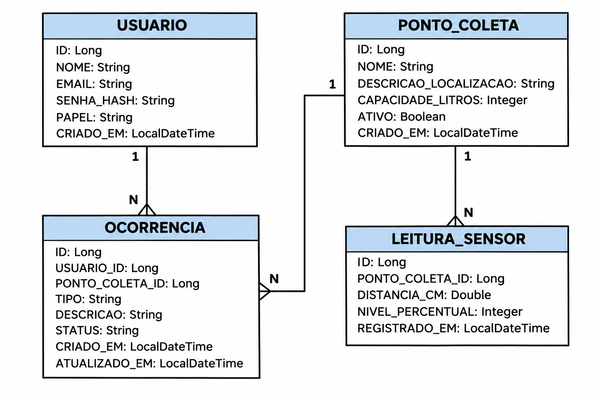

# Binova - Java Advanced | FIAP Global Solution 2026/2

**Tema:** CitizenTech  
**Disciplina:** Java Advanced  
**Turma:** 2TDSPS  
**Repositório:** https://github.com/GustavoSiciliano/GlobalSolution_2026_Java  
**Vídeo pitch:**

> **Roteiro:** execute o projeto conforme a [seção 6](#6-configuração-e-execução), abra o **Swagger UI** e siga os testes da [seção 8](#8-roteiro-de-avaliação-pelo-swagger).

## 1. Apresentação do projeto

O **Binova** é uma proposta CitizenTech para monitoramento de pontos de coleta de resíduos. Cidadãos podem consultar a situação das lixeiras e registrar ocorrências; a aplicação também recebe medições de sensores e ajuda a identificar pontos que precisam de atenção.

Nesta disciplina, foi desenvolvida uma API REST com **Java 21 e Spring Boot 4.1.2**. A API oferece autenticação JWT, autorização por papel, consultas com Spring Data JPA, paginação, tratamento de erros, cache, respostas HATEOAS e monitoramento pelo Actuator. Para facilitar a execução local, utiliza **H2 persistente em arquivo**. Não é necessário ter um sensor físico: as leituras podem ser registradas pela própria API.

## 2. Integrantes

| Integrante | RM |
|---|---|
| Gustavo de Jesus | 567926 |
| Gustavo Siciliano | 568419 |
| Samuel Keniti | 567614 |
| Manuel Pedro | 567458 |
| Vinicius Morrone | 566884 |

**Instituição:** FIAP  
**Curso:** Análise e Desenvolvimento de Sistemas  
**Turma:** 2TDSPS

## 3. Tecnologias utilizadas

| Tecnologia | Uso no Binova |
|---|---|
| Java 21, Spring Boot e Spring Web MVC | Construção da API REST |
| Spring Data JPA, Hibernate e H2 | Persistência, relacionamentos e consultas |
| Bean Validation e `@RestControllerAdvice` | Validações e erros JSON |
| Spring Security, JWT e BCrypt | Login, permissões e proteção de senhas |
| Spring Cache | Cache das consultas de detalhes dos pontos |
| Spring HATEOAS | Links para os recursos e ações relacionadas |
| Spring Boot Actuator | `health`, `info` e `metrics` |
| Swagger / OpenAPI | Documentação e execução interativa dos endpoints |
| JUnit 5 e testes Spring | Testes automatizados da aplicação |

### Estrutura principal

```text
GlobalSolution_2026_Java/
├── pom.xml
├── mvnw
├── mvnw.cmd
├── README.md
├── Diagram/
│   └── Diagrama.png
└── src/
    ├── main/
    │   ├── java/br/com/fiap/binova/
    │   │   ├── api/
    │   │   ├── config/
    │   │   ├── domain/
    │   │   ├── dto/
    │   │   ├── repository/
    │   │   ├── security/
    │   │   ├── service/
    │   │   └── specification/
    │   └── resources/application.yaml
    └── test/
        ├── java/br/com/fiap/binova/
        └── resources/
```

## 4. Modelo de dados e relacionamentos JPA

As quatro entidades persistidas são `Usuario`, `PontoColeta`, `Ocorrencia` e `LeituraSensor`.



| Relacionamento | Cardinalidade | Implementação JPA |
|---|---|---|
| `Usuario` → `Ocorrencia` | 1:N | `@OneToMany(mappedBy = "usuario")` / `@ManyToOne` |
| `PontoColeta` → `Ocorrencia` | 1:N | `@OneToMany(mappedBy = "pontoColeta")` / `@ManyToOne` |
| `PontoColeta` → `LeituraSensor` | 1:N | `@OneToMany(mappedBy = "pontoColeta")` / `@ManyToOne` |

As entidades filhas utilizam `@ManyToOne(fetch = FetchType.LAZY, optional = false)` com `@JoinColumn`. O `LAZY` evita carregar imediatamente as entidades relacionadas; a camada de serviços controla o acesso aos dados. **Não existe `cascade` explícito** nessas associações. Os IDs utilizam `GenerationType.IDENTITY`; os valores de medição são `BigDecimal`, as datas `OffsetDateTime` e os campos de papel/tipo/status são enums persistidos como texto.

O ponto de coleta possui **exclusão lógica**: `DELETE` define `ativo = false` e preserva o histórico de leituras e ocorrências.

## 5. Banco de dados e contas de teste

O arquivo `src/main/resources/application.yaml` configura o banco H2 local:

| Configuração | Valor |
|---|---|
| URL JDBC | `jdbc:h2:file:./data/binova;DB_CLOSE_ON_EXIT=FALSE` |
| Usuário | `sa` |
| Senha | Em branco |
| Console | http://localhost:8080/h2-console |
| Tabelas | Gerenciadas pelo Hibernate com `ddl-auto: update` |

Os dados ficam em `data/binova.mv.db` e persistem entre reinicializações.

### Contas de demonstração

| Papel | E-mail | Senha de demonstração |
|---|---|---|
| `ADMIN` | `admin@binova.local` | `AdminLocal2026` |
| `CIDADAO` | `cidadao@binova.local` | `CidadaoLocal2026` |

Esses são **exemplos para uma execução local**, criados somente quando a opção de demonstração está habilitada e as senhas são fornecidas.

## 6. Configuração e execução

### 6.1 Pré-requisitos

- JDK **21** instalado;
- PowerShell no Windows (ou terminal compatível no Linux/macOS);
- Conexão à internet na primeira execução para baixar dependências Maven;
- Projeto aberto na pasta que contém `pom.xml`.

Clone o repositório (ou extraia o ZIP e abra sua pasta):

```powershell
git clone https://github.com/GustavoSiciliano/GlobalSolution_2026_Java.git
cd .\GlobalSolution_2026_Java
java -version
.\mvnw.cmd -version
```

### 6.2 Preparar os perfis de demonstração

No **mesmo PowerShell** em que você iniciará o Spring Boot:

```powershell
$env:BINOVA_DEMO = "true"
$env:APP_DEMO_ADMIN_PASSWORD = "AdminLocal2026"
$env:APP_DEMO_CIDADAO_PASSWORD = "CidadaoLocal2026"
```

A configuração real utiliza `app.demo.enabled` (variável `BINOVA_DEMO`) e as senhas de ambiente `APP_DEMO_ADMIN_PASSWORD` e `APP_DEMO_CIDADAO_PASSWORD`. Para não criar as contas de exemplo, utilize `BINOVA_DEMO=false` - nesse caso, o roteiro abaixo exigirá contas cadastradas por outro meio.

O JWT usa uma chave temporária em desenvolvimento quando `JWT_SECRET_BASE64` não está definida. Tokens antigos deixam de valer ao reiniciar a aplicação. Se configurar uma chave própria, mantenha o segredo fora do GitHub e utilize Base64 de pelo menos 32 bytes.

### 6.3 Compilar e iniciar

```powershell
.\mvnw.cmd clean verify
.\mvnw.cmd spring-boot:run
```

O primeiro comando compila e executa os testes automatizados; o segundo inicia a aplicação. Mantenha o terminal da API aberto.

| Recurso | Endereço local |
|---|---|
| **Swagger UI - avaliação da API** | http://localhost:8080/swagger-ui.html |
| OpenAPI JSON | http://localhost:8080/v3/api-docs |
| H2 Console | http://localhost:8080/h2-console |
| Actuator Health | http://localhost:8080/actuator/health |
| Actuator Info | http://localhost:8080/actuator/info |

### 6.4 Conferir as tabelas pelo H2

Com a API iniciada, abra http://localhost:8080/h2-console e use a URL `jdbc:h2:file:./data/binova`, usuário `sa` e senha vazia. Execute:

```sql
SELECT * FROM USUARIO;
SELECT * FROM PONTO_COLETA;
SELECT * FROM LEITURA_SENSOR;
SELECT * FROM OCORRENCIA;
```

O console H2 integrado à aplicação é preferível a abrir outra instância externa sobre o mesmo arquivo do banco.

## 7. Endpoints principais

| Método | Rota | Acesso | Resposta de sucesso |
|---|---|---|---|
| `POST` | `/api/auth/cadastro` | Público | 201 |
| `POST` | `/api/auth/login` | Público | 200 + JWT |
| `GET` | `/api/usuarios/me` | Autenticado | 200 |
| `GET` | `/api/pontos-coleta` | Público | 200 |
| `GET` | `/api/pontos-coleta/busca-nome?nome=...` | Público | 200 |
| `GET` | `/api/pontos-coleta/{id}` | Público | 200 |
| `GET` | `/api/pontos-coleta/{id}/situacao` | Público | 200 |
| `POST` | `/api/pontos-coleta` | ADMIN | 201 |
| `PUT` | `/api/pontos-coleta/{id}` | ADMIN | **200 + JSON** |
| `DELETE` | `/api/pontos-coleta/{id}` | ADMIN | **204** (desativação lógica) |
| `PATCH` | `/api/pontos-coleta/{id}/reativar` | ADMIN | 200 |
| `GET` | `/api/pontos-coleta/{pontoId}/leituras` | Autenticado | 200 |
| `GET` | `/api/pontos-coleta/{pontoId}/leituras/{id}` | Autenticado | 200 |
| `POST` | `/api/pontos-coleta/{pontoId}/leituras` | ADMIN | 201 |
| `GET`, `POST` | `/api/ocorrencias` | Autenticado | 200 / 201 |
| `GET`, `PUT`, `DELETE` | `/api/ocorrencias/{id}` | Autenticado, conforme autoria e regras | 200 / 204 |
| `PATCH` | `/api/ocorrencias/{id}/status` | ADMIN | 200 |
| `GET` | `/actuator/health`, `/actuator/info` | Público | 200 |
| `GET` | `/actuator/metrics` | ADMIN | 200 |

As listagens utilizam `page`, `size` e `sort`; pontos aceitam `termo` e `ativo`, ocorrências aceitam `status`.

## 8. Roteiro de avaliação pelo Swagger

Acesse **http://localhost:8080/swagger-ui.html**. Em cada endpoint: abra a operação, clique em **Try it out**, preencha o JSON, clique em **Execute** e confira **Response code** e **Response body**. Siga a sequência abaixo. **Use os IDs retornados pelo próprio Swagger, sem pressupor registros anteriores.**

### 8.1 Autenticação JWT (ADMIN)

Abra `POST /api/auth/login` e envie:

```json
{
  "email": "admin@binova.local",
  "senha": "AdminLocal2026"
}
```

**Esperado:** HTTP **200** e objeto com `token`, `tipo`, `expiraEmSegundos` e `papel`. Copie **somente o valor de `token`** e clique em **Authorize** no Swagger para inserir o JWT no esquema `bearerAuth`. A autorização deverá ser enviada como `Authorization: Bearer <token>`.

Se a conta já existia no H2 com outra senha, use a senha anterior ou configure um banco novo **exclusivo para testes**, sem apagar dados importantes.

### 8.2 POST - cadastrar ponto de coleta

Abra `POST /api/pontos-coleta` com o perfil ADMIN autorizado:

```json
{
  "nome": "Ecoponto Avaliacao Java",
  "descricaoLocalizacao": "Entrada da biblioteca",
  "capacidadeLitros": 80
}
```

**Esperado:** HTTP **201 Created**, retorno do ponto e cabeçalho `Location` com `/api/pontos-coleta/{id}`. **Anote o `id` criado** para os próximos testes.

### 8.3 GET - consultar ponto, filtros e HATEOAS

Execute no Swagger:

1. `GET /api/pontos-coleta/{id}` com o ID recém-criado → **200**, incluindo os dados e os links `_links` como `self`, `situacao` e `leituras`;
2. `GET /api/pontos-coleta` → **200**, com paginação; pode testar `page=0`, `size=10`, `sort=id,asc`;
3. `GET /api/pontos-coleta?ativo=true` → **200**, filtrando os ativos;
4. `GET /api/pontos-coleta/busca-nome?nome=Ecoponto` → **200**, para demonstrar a consulta JPQL.

As respostas de detalhes são cacheadas pelo serviço; o cache é invalidado nas operações de alteração.

### 8.4 PUT - atualizar ponto de coleta

Abra `PUT /api/pontos-coleta/{id}` com o **mesmo ID**, e envie:

```json
{
  "nome": "Ecoponto Java Atualizado",
  "descricaoLocalizacao": "Entrada principal - Bloco B",
  "capacidadeLitros": 120
}
```

**Esperado:** HTTP **200 OK** com o registro atualizado. Repita `GET /api/pontos-coleta/{id}` para confirmar os novos valores. O `GET` após a edição também demonstra que o cache não manteve os dados antigos.

### 8.5 DELETE - desativação lógica

Abra `DELETE /api/pontos-coleta/{id}` com o mesmo ID e execute como ADMIN.

**Esperado:** HTTP **204 No Content**. Faça `GET /api/pontos-coleta/{id}`: o ponto ainda existe, mas `ativo` deve estar como `false`. Isso preserva leituras e ocorrências.

Para continuar a demonstração do sensor, execute `PATCH /api/pontos-coleta/{id}/reativar` como ADMIN (**200**).

### 8.6 Tratamento de erros - 400 e 404

**POST inválido - 400 Bad Request.** Abra `POST /api/pontos-coleta` como ADMIN e envie:

```json
{
  "nome": "",
  "descricaoLocalizacao": "",
  "capacidadeLitros": 0
}
```

**Esperado:** HTTP **400** com erro padronizado em JSON e campos inválidos.

**GET inexistente - 404 Not Found.** Abra `GET /api/pontos-coleta/{id}` com `999999999`.

**Esperado:** HTTP **404** em JSON, com a mensagem de recurso não encontrado.

### 8.7 Segurança por papéis - 403

No Swagger, utilize **Authorize** com um novo token do perfil CIDADAO. Para obtê-lo, execute `POST /api/auth/login`:

```json
{
  "email": "cidadao@binova.local",
  "senha": "CidadaoLocal2026"
}
```

Com o token do cidadão, tente `POST /api/pontos-coleta` usando o JSON válido do passo 8.2.

**Esperado:** HTTP **403 Forbidden**. A rota de cadastro de pontos é permitida apenas para ADMIN. Depois, autorize-se novamente com o token de ADMIN para os testes administrativos restantes.

### 8.8 Leitura de sensor e situação do ponto

Utilize o mesmo ponto já **reativado** e a autenticação ADMIN. Abra `POST /api/pontos-coleta/{pontoId}/leituras`, preencha o ID e envie:

```json
{
  "distanciaCm": 12,
  "nivelPercentual": 85
}
```

**Esperado:** HTTP **201 Created**. Em seguida, execute `GET /api/pontos-coleta/{id}/situacao` (**200**). Uma leitura válida e recente de 85% deve produzir `PROXIMA_DO_LIMITE`. Após **15 minutos**, a mesma leitura poderá resultar em `SEM_DADOS_ATUALIZADOS`. Com usuário autenticado, consulte também o histórico pelo endpoint `GET /api/pontos-coleta/{pontoId}/leituras`.

### 8.9 Ocorrências registradas por cidadãos

Autorize o perfil CIDADAO e execute `POST /api/ocorrencias`:

```json
{
  "pontoColetaId": 1,
  "tipo": "LIXEIRA_CHEIA",
  "descricao": "Lixeira cheia na entrada da biblioteca"
}
```

**Substitua `1` pelo ID do ponto reativado.** O usuário da ocorrência é definido pelo JWT; não é enviado no JSON. **Esperado:** HTTP **201 Created**.

Com o perfil ADMIN, utilize `PATCH /api/ocorrencias/{id}/status`:

```json
{
  "status": "EM_ATENDIMENTO"
}
```

**Esperado:** HTTP **200**, demonstrando a alteração do atendimento.

### 8.10 Actuator e monitoramento

Acesse no navegador ou pelo Swagger, quando disponíveis na lista de endpoints:

- http://localhost:8080/actuator/health - **200**, saúde da API;
- http://localhost:8080/actuator/info - **200**, identificação da aplicação;
- http://localhost:8080/actuator/metrics - **200 apenas com JWT ADMIN**; fora do Swagger, use um cliente HTTP que permita enviar o cabeçalho `Authorization: Bearer <token>`.

A rota `metrics` está protegida. Não é necessário tornar esse endpoint público para a demonstração.

## 9. Decisões técnicas e justificativas

### 9.1 Consultas JPA

- **Método derivado:** `PontoColetaRepository.findByAtivoTrue(Pageable)` lista pontos ativos com paginação; `LeituraSensorRepository.findFirstByPontoColetaIdOrderByRegistradoEmDesc` recupera a medição mais recente. São consultas simples expressas pelo nome do método.
- **JPQL (`@Query`):** `PontoColetaRepository.buscarPorNome` faz busca textual com `lower(...)` e paginação, útil para localizar lixeiras por nome sem diferenciar maiúsculas e minúsculas.
- **Specification:** `PontoSpecifications.filtros` combina dinamicamente os filtros opcionais de texto e atividade. Isso evita diversos métodos específicos para cada combinação.
- **Paginação e ordenação:** `Pageable` reduz o volume de dados das listagens e permite definir `page`, `size` e `sort`.

### 9.2 Cache

`PontoColetaService.consultar(Long id)` utiliza `@Cacheable(value = "pontos", key = "#id")` na consulta de detalhes de cada ponto. `criar`, `atualizar`, `desativar` e `reativar` utilizam `@CacheEvict(value = "pontos", allEntries = true)` para invalidar a informação depois de alterações. O cache configurado é **simples e em memória**.

### 9.3 Segurança JWT e CORS

O login valida e-mail e senha (BCrypt), emite JWT e permite acessar endpoints protegidos por papel. O perfil `ADMIN` pode criar e administrar pontos e lançar leituras; o `CIDADAO` pode registrar ocorrências. A verificação de permissões ocorre no Spring Security e nos serviços, não apenas na interface do Swagger. O CORS permite, por padrão, `http://localhost:3000`, `http://localhost:5173` e `http://localhost:8081`, configuráveis por `APP_CORS_ALLOWED_ORIGINS`.

### 9.4 HATEOAS

Os detalhes dos pontos e os recursos de ocorrências usam `EntityModel`, incluindo links `self` e para recursos relacionados. A presença de links administrativos depende do perfil e do estado do recurso; as autorizações reais continuam sendo aplicadas pela segurança.

### 9.5 Regras de negócio

Uma leitura válida e recente define a situação do ponto: abaixo de 50% = `DISPONIVEL`; de 50% até menos de 80% = `ATENCAO`; de 80% a 100% = `PROXIMA_DO_LIMITE`. Na ausência de leitura, após 15 minutos ou com dados inválidos, a situação é `SEM_DADOS_ATUALIZADOS`.

## 10. Testes automatizados

O código contém testes Spring/JUnit para inicialização do contexto, JWT, cálculo de situação e fluxo de API com autenticação, permissões, pontos, leituras, ocorrências e demais recursos. Execute na raiz do repositório:

```powershell
.\mvnw.cmd clean verify
```

## 11. Problemas comuns e correções

| Sintoma | Verificação e solução |
|---|---|
| Java ou Maven não encontrado | Confira `java -version` (JDK 21). Use `mvnw.cmd`, não é necessário instalar Maven globalmente. |
| API não inicia: faltam senhas de demonstração | No mesmo terminal, defina `BINOVA_DEMO=true`, `APP_DEMO_ADMIN_PASSWORD` e `APP_DEMO_CIDADAO_PASSWORD`; depois inicie de novo. |
| Login do exemplo retorna 401 | Confira o perfil, a senha e se já existem contas antigas no H2; reiniciar não altera senhas antigas. |
| Swagger exibe 401 em operação protegida | Faça login e clique em **Authorize**; informe um token válido. |
| Swagger exibe 403 no POST de pontos | É necessário utilizar JWT com papel `ADMIN`, não `CIDADAO`. |
| Token deixa de funcionar após reinício | Gere um novo token: a chave padrão do JWT é temporária em desenvolvimento. |
| Porta 8080 em uso | Encerre a outra API ou defina `$env:SERVER_PORT="8081"` antes de iniciar; ajuste as URLs dos testes. |
| HTTP 404 / 405 | Verifique o ID e o método; a leitura usa `GET` e `POST` em rota aninhada, não `DELETE`. |
| H2 ocupado / arquivo em uso | Não inicie duas instâncias usando o mesmo arquivo H2; use o console da aplicação iniciada. |
| Necessidade de dados limpos para avaliar | Em um ambiente de testes, use um novo arquivo H2 configurado via `SPRING_DATASOURCE_URL`; não apague dados existentes sem confirmação. |

Para conferir a porta no Windows:

```powershell
Get-NetTCPConnection -LocalPort 8080 -State Listen -ErrorAction SilentlyContinue |
    Select-Object LocalPort, OwningProcess
```

Se for necessário usar outra porta, faça antes de iniciar:

```powershell
$env:SERVER_PORT = "8081"
.\mvnw.cmd spring-boot:run
```

Ao iniciar novamente em outro PowerShell, configure também as variáveis de demonstração nesse terminal.